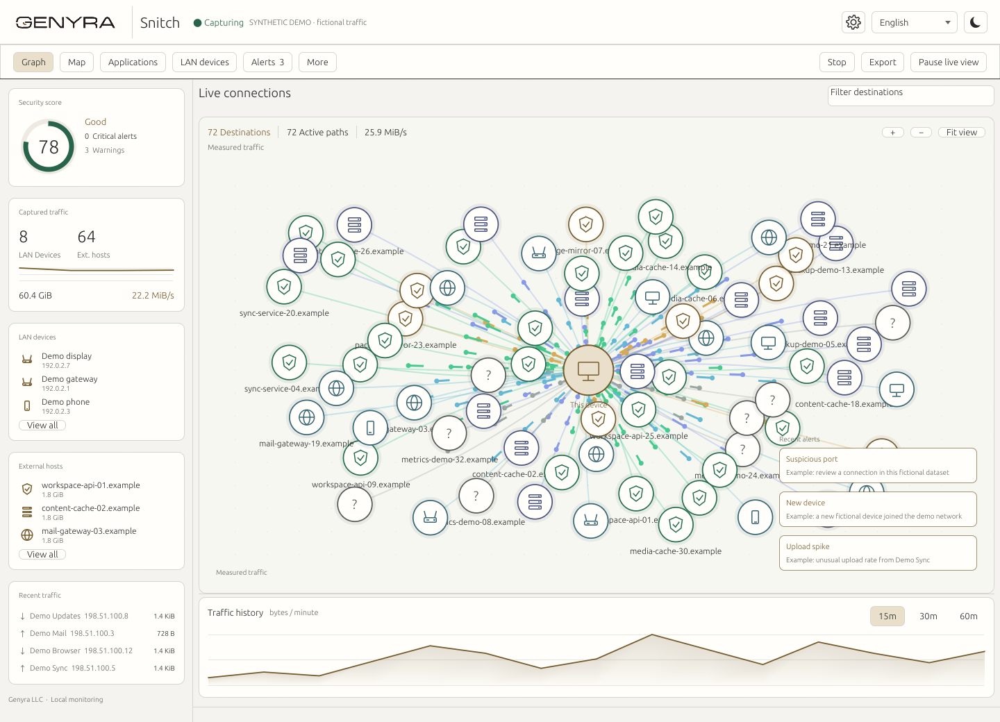
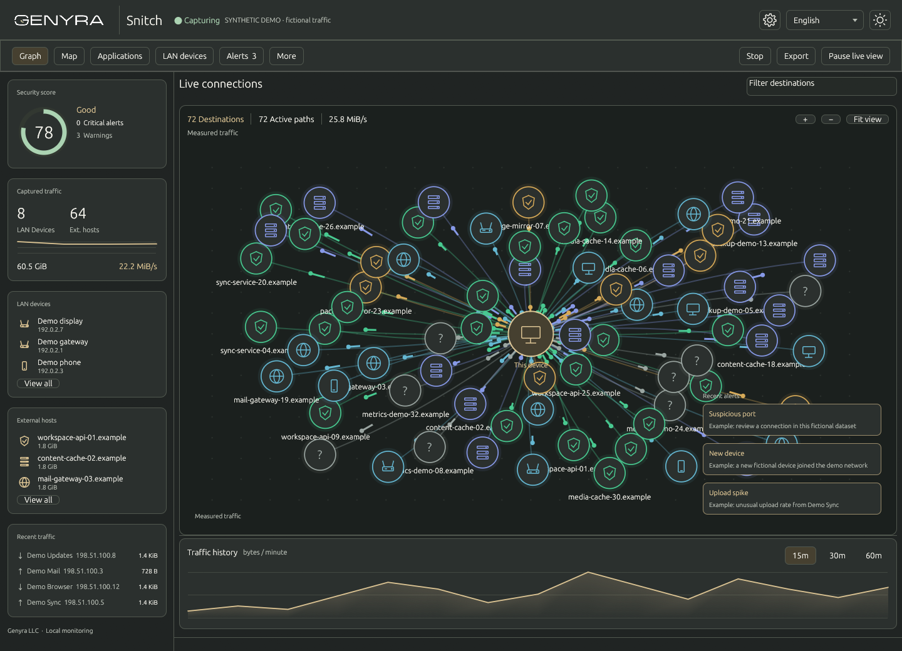
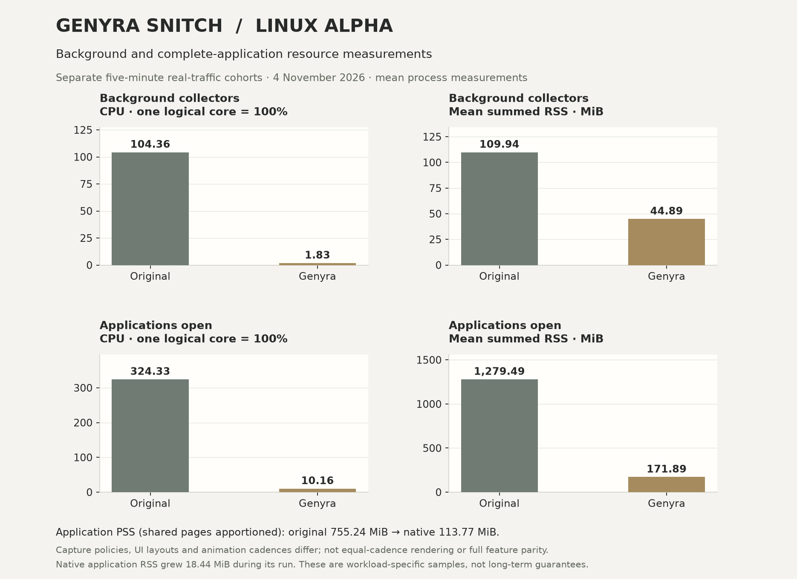

<p align="center"><a href="https://genyra.com"><picture><source media="(prefers-color-scheme: dark)" srcset="ui/public/brand/genyra-light.png"></picture></a></p>
<h1 align="center">Genyra Snitch</h1>
<p align="center"><strong>Linux alpha · Native desktop 0.1.0-alpha.5</strong></p>
<p align="center"><strong>Know what your apps connect to.</strong><br>Network visibility, application firewall controls and local investigation tools — by Genyra LLC.</p>
<p align="center"><a href="https://github.com/GenyraLLC/genyra-snitch/actions">Builds</a> · <a href="docs/FEATURES.md">Feature coverage</a> · <a href="docs/PERFORMANCE.md">Resource usage</a> · <a href="docs/BUILD.md">Build &amp; run</a></p>

Genyra Snitch is a Rust fork of [Snitch by aiXis Studio](https://github.com/aixisstudio/Snitch), with a native desktop and collector for network visibility, application controls and local investigation. The native application requires no Python, Node or browser runtime.

This is a **Linux x86-64 alpha**. Windows and macOS adapters, native builds and synthetic service-lifecycle tests are available, while live capture and privileged feature parity on those platforms remain under validation. Native detection algorithms can produce different scores from Python. [Feature coverage and limits](docs/FEATURES.md) distinguish implementation from validation.

All current development is on **`main`**, including the native desktop. Full application and cross-platform parity remain in progress; see [current work and outstanding gaps](docs/NATIVE-REWRITE.md). The earlier React interface is retained for compatibility checks and reference.

The native desktop also has an optional **background monitoring** mode and native
startup-service controls. See [setup, privileges and lifecycle](docs/BACKGROUND-SERVICE.md).

### Native interface — Linux alpha

Actual native renders with **entirely fictional example data**. No personal
servers, real devices or private connections appear in these screenshots.

<table>
<tr><th>Light mode · alpha</th><th>Dark mode · alpha</th></tr>
<tr>
<td><a href="docs/images/native-light.png"></a></td>
<td><a href="docs/images/native-dark.png"></a></td>
</tr>
</table>

[Full-size gallery, provenance and reproduction](docs/images/README.md).
The Rust [gallery fixture](examples/gallery_fixture.rs) uses reserved `.example`
names and documentation IP ranges; it performs no capture or host inspection.

### What you get

- A live connection graph and map, per-process attribution, LAN device discovery, offline GeoIP/ASN, traffic history and a bounded forensic packet buffer.
- IP/CIDR/domain/port/process firewall rules, throttling, sinkholes, lockdown and first-connection decisions through native NFQUEUE.
- Heuristic and statistical alerts, watchlists, suppressions, combined custom rules, Sigma import and YARA-L export.
- Native eBPF hooks, Frida inspection, integrity and memory checks, hardware counters, process controls and an isolated execution tool.
- Agent enrollment, remote sensor ingestion, peer IOC exchange, fleet views and JSON/CSV/STIX/ECS/PCAP investigation exports.
- Optional threat providers, webhooks/syslog, local Ollama explanations and user-supplied GGUF models through native llama.cpp.

Administrator-only tools still require administrator privileges. Missing permissions are reported; a configured rule is not described as enforced when the OS rejected it. The application starts on loopback and requires its local API token.

### Technical specifications

| Component | Current implementation |
| --- | --- |
| Native application | Rust 2021; separate collector and desktop executables. No Python, Node, Electron or browser runtime required for the native application. |
| Desktop rendering | egui/eframe 0.33 with Glow/OpenGL; Wayland and X11 on Linux. Offline world map, connection graph and measured-traffic pulses. |
| Appearance and languages | Hosting-style Genyra light/dark themes, tabbed navigation and a persistent overview/timeline. Eight languages for navigation and the main overview; some advanced descriptions and collector messages remain in English. |
| Capture | libpcap on Linux/macOS; separately installed Npcap on Windows. IPv4, IPv6 and ARP filter; non-promiscuous capture; 4,096-byte snapshot length; requested 4 MiB capture buffer. Longer packets may be truncated in inspection/export. |
| Collector scheduling | Tokio with two async runtime workers, plus dedicated capture and other task workers. This is not a two-thread limit for the whole process. |
| Live state | Up to 4,096 remote graph nodes and 8,192 cached names; approximately 4 MiB of retained packet bytes, plus metadata. |
| Desktop workload | Force simulation limited to 384 nodes; up to 192 traffic pulses; active scene animation requests at 50 ms intervals. Bounded I/O queues; minimized windows suspend polling and streaming. |
| Storage | Local SQLite in WAL mode, batched writes. Traffic/history retention defaults to 24 hours and is configurable from 1 to 8,760 hours; stored alert history is preserved. Disk use has no fixed total cap. |
| Geolocation | Optional local MaxMind City/ASN databases, mapped read-only into memory; no online map-tile service required. GeoIP is an estimate, not device GPS. |
| Local API | Authenticated HTTP/WebSocket on loopback by default; persistent random 256-bit API token. Desktop reads credentials from a local file. |
| Background operation | Optional collector-only mode after closing the desktop. Startup integration: Linux systemd user service, macOS launchd LaunchAgent, Windows native SCM service. |
| Optional inference | Native llama.cpp with user-supplied GGUF weights, or a local Ollama endpoint. Model memory and CPU are additional costs. |
| License / origin | AGPL-3.0; independent Genyra fork of aiXis Studio's Snitch, with upstream notices retained. |

| Platform | Validation scope |
| --- | --- |
| Linux x86-64 | Alpha; live capture tested. Native desktop, service lifecycle and targeted Wayland/NVIDIA occlusion regression tested. Privileged features require separate permissions. |
| macOS ARM64 | Native CI builds/tests on macOS 14; synthetic LaunchAgent lifecycle tested. Live capture and privileged feature parity remain under validation. |
| Windows x86-64 | Native CI builds/tests on Windows Server 2022; synthetic SCM lifecycle tested. Live use requires Npcap; capture and privileged feature parity remain under validation. |

These are tested targets, not minimum OS versions or a guarantee of feature parity. Minimum RAM, sustained maximum throughput and a complete native-desktop memory baseline have not been established. See [build requirements](docs/BUILD.md), [platform gaps](docs/NATIVE-REWRITE.md) and [resource measurements](docs/PERFORMANCE.md).

### Build and try

On Linux, install the native dependencies listed in [the build guide](docs/BUILD.md), then:

```sh
cargo build --release --locked
cargo build --release --locked --manifest-path desktop/Cargo.toml
cp target/release/genyra-snitch desktop/target/release/
./desktop/target/release/genyra-snitch-desktop --demo
```

This opens the native desktop with synthetic connections. Demo mode never captures or enforces host policy. For a Linux app-menu entry, run the desktop binary with `--install`; see [native desktop setup](docs/NATIVE-REWRITE.md#linux-app-menu-installation).

For live capture, run the binary with the required privileges; see [live capture and desktop usage](docs/BUILD.md). To migrate an existing installation, stop the old collector, back up its data and token, then point `SNITCH_DATA_DIR` at that directory. Never run two collectors against the same database.

### Measured resource use

On **4 November 2026**, concurrent real-traffic Linux comparisons measured each
mode for **five minutes after a 45-second warm-up**. The application run used
the revised native alpha.5 UI and counted every collector, frontend and helper
process. CPU percentages use **one logical core = 100%**; RSS values are means.

| Mode | Original CPU | Native CPU | Original RSS | Native RSS |
| --- | ---: | ---: | ---: | ---: |
| Background collector | 104.36% | 1.83% | 109.94 MiB | 44.89 MiB |
| Complete application open | 324.33% | 10.16% | 1,279.49 MiB | 171.89 MiB |

In these workloads, native mean RSS was **59.17% lower in background mode** and
**86.57% lower with the application open**. Whole-app **PSS**, which apportions
shared resident pages, was **755.24 MiB versus 113.77 MiB**: **84.94% lower**.
Native used two counted processes versus the original's nine.



**Scope and trade-offs:** capture policies and feature coverage differ. Native
update callbacks averaged **38.16/s**, versus Electron rAF at **116.39/s**; this
is not equal-cadence rendering or hardware-presented FPS. Native application
RSS grew **18.44 MiB** during its window. The results support lower process
resource use in these runs, not multi-hour stability, complete parity or a
universal performance guarantee. They exclude external model servers and GPU VRAM.

The [full application report](docs/benchmarks/2026-11-04-linux-application.md)
includes memory growth, timing probes, exact data and build identities. The
[background report](docs/benchmarks/2026-11-04-linux-capture.md) and
[resource guide](docs/PERFORMANCE.md) retain the earlier sample with higher
native RSS. The background cohort was reused unchanged; its averages must not
be subtracted from the separate application cohort to estimate frontend costs.

### Privacy and provenance

No connection captures, host databases, API keys, desktop integrations or workstation configuration are included in this repository. The test harness creates synthetic traffic in temporary directories. Vendor telemetry is absent. Reverse DNS may use the system resolver; downloads and external integrations require explicit configuration or consent. Recent packet bytes can be retained locally for protocol inspection and PCAP export — this is not a “payloads are never read” promise.

The software remains **AGPL-3.0**. Upstream authorship is preserved in [LICENSE](LICENSE), [NOTICE](NOTICE) and [UPSTREAM.json](UPSTREAM.json). Genyra Snitch is maintained independently by Genyra LLC; it is not an official upstream release.
