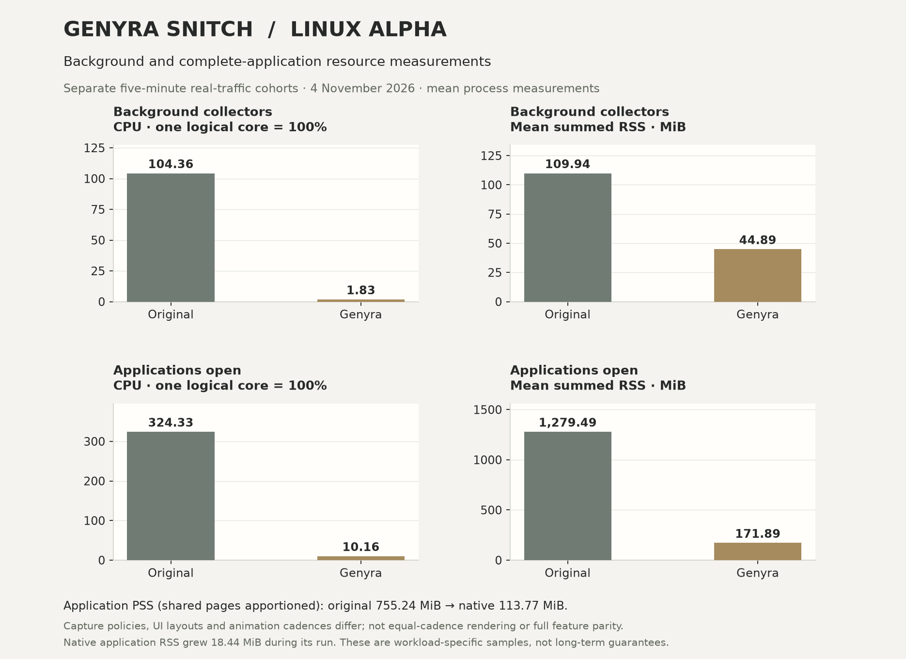
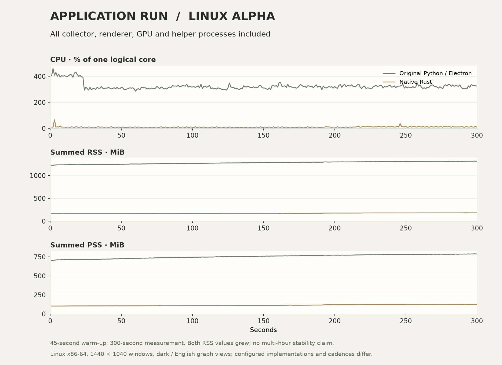
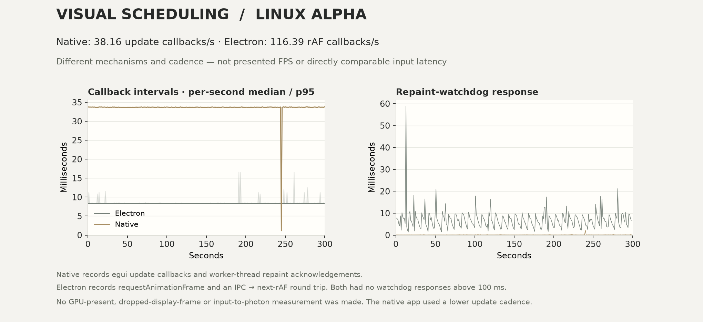

# Background and full-application comparison — 4 November 2026

The native implementation used less CPU and resident memory in both recorded
Linux workloads. The application run used the revised **native desktop
0.1.0-alpha.5**, including its overview, live graph, alerts and timeline.

**Status: Linux alpha.** These measurements do not make it a production-ready
release or establish live-capture/privileged-feature parity on Windows or macOS.

| Mode / measurement | Original Snitch | Genyra Snitch |
| --- | ---: | ---: |
| Background collector: average CPU | 104.36% | 1.83% |
| Background collector: mean RSS | 109.94 MiB | 44.89 MiB |
| Application open: average CPU, whole process tree | 324.33% | 10.16% |
| Application open: mean summed RSS | 1,279.49 MiB | 171.89 MiB |
| Application open: mean summed PSS | 755.24 MiB | 113.77 MiB |
| Application open: processes counted | 9 | 2 |

**100% CPU means one logical core.** The original application averaged about
3.24 cores across its processes; the native application averaged 0.10 cores.
RSS is resident memory summed over the app's processes; it can count shared
pages multiple times. PSS apportions shared resident pages, reducing that
double counting. Every measured process supplied readable PSS throughout.

The background sample measured **98.24% lower CPU and 59.17% lower mean RSS**.
The application sample measured **96.87% lower CPU, 86.57% lower mean summed
RSS and 84.94% lower mean PSS**. These results describe the tested configurations
and workload, with the differences below. They are not universal savings claims.

## Method and scope

The completed [background measurement](2026-11-04-linux-capture.md) was reused
unchanged. The application comparison was run separately after the UI revision:
45 seconds of warm-up, then **300 seconds** of concurrent real traffic on the
same physical interface, sampled once per second. Both apps had fresh separate
SQLite databases and identical local City/ASN data.

Both compositor windows were **1440 × 1040 logical pixels**, scale 1, dark mode,
English, graph view. Their content layouts and window chrome differ. Normal
controls were enabled, with no policy changes or on-demand inspection/model
jobs. The collectors had only `CAP_NET_RAW`; frontends had no capabilities.

CPU includes all threads in the collector and every frontend descendant,
including Electron's GPU, renderer, broker and utility processes. Process
identities were checked; no measured process was added or exited during the
window. All **600 process-tree samples** were present. Observer processes,
unrelated applications, compositor, kernel buffers and GPU VRAM are excluded.

The native source was commit
[`375ce8c`](https://github.com/GenyraLLC/genyra-snitch/commit/375ce8cb4ef0dc0c403dad35d7d8d398f253136e).
Original Snitch was 1.6.4, source `062f2a8c3ba95ac811988710579874100d667956`,
Python 3.12.15 and Electron 44.9.1. Its main/preload/frontend were retained; a
private test adapter attached the separately measured Python collector and
installed numeric timing probes. Both frontends took a screenshot during warm-up
and had timing probes enabled. Instrumentation is included in their process costs.

The host was an Intel Core i9-14900K with 32 logical CPUs and an NVIDIA RTX
4080 SUPER, driver 615.78.08. This is Linux evidence; platform builds and tests
on Windows/macOS do not establish equivalent resource savings there.

## Memory growth and traffic

| During the application window | Original | Native |
| --- | ---: | ---: |
| Summed RSS at start | 1,221.71 MiB | 162.80 MiB |
| Summed RSS at end | 1,314.68 MiB | 181.23 MiB |
| Highest sampled summed RSS | 1,316.69 MiB | 183.23 MiB |
| RSS endpoint growth | 92.97 MiB | 18.44 MiB |
| Delivered / processed packets | 100,824 | 100,792 |
| Graph nodes at start → end | 53 → 93 | 67 → 108 |

Both applications' RSS grew. Five minutes does not establish multi-hour
stability or absence of a leak. The node counts also grew, but this run does
not isolate the cause of each memory allocation. A longer soak is separate work.

Native libpcap reported **zero kernel and interface drops**. Python reported
zero packet-queue drops; its API does not expose kernel drop counters. Capture
policies differ: native uses a non-promiscuous 4,096-byte IPv4/IPv6/ARP snapshot,
Python a promiscuous 65,535-byte IPv4/IPv6 snapshot. Algorithms, detection scores,
observed graph sizes and feature coverage also differ. This is an implementation
comparison, not identical capture policies or complete functional parity.

Do not subtract the background averages from the application averages to infer
frontend costs: they are separate concurrent cohorts with different traffic and
host activity.

## Visual scheduling and responsiveness

| Probe observation | Original Electron | Native egui |
| --- | ---: | ---: |
| Average UI callbacks per second | 116.39 | 38.16 |
| Median callback interval | 8.30 ms | 33.67 ms |
| 95th percentile callback interval | 8.40 ms | 33.84 ms |
| Largest callback interval | 174.90 ms | 34.44 ms |
| Repaint-watchdog samples | 299 | 300 |
| 95th percentile watchdog response | 11.06 ms | 0.16 ms |
| Largest watchdog response | 58.81 ms | 2.12 ms |
| Watchdog responses above 100 ms | 0 | 0 |

The native app ran a **lower update cadence**. The CPU result is not normalized
to equal rendering cadence. It does not establish higher animation FPS or
equivalent visual workloads.

The timing mechanisms differ: native records egui update callbacks, with a
worker-thread repaint request acknowledged at the next update; Electron records
`requestAnimationFrame`, with an IPC request resolved through the next rAF reply.
The watchdog results show that each mechanism responded during the run. They
are not directly comparable input-to-photon latencies. Neither measures
hardware-presented FPS, dropped display frames, GPU execution time or user input
latency. No relative visual-speed claim follows from these probe numbers.

## Evidence and private data

- [Exact aggregates, build hashes and conditions](2026-11-04-linux-application.json)
- [All 600 per-second application resource samples](2026-11-04-linux-application.csv)
- [Numeric native callback samples, compressed CSV](2026-11-04-native-callbacks.csv.gz)
- [Numeric Electron callback samples, compressed CSV](2026-11-04-electron-callbacks.csv.gz)
- [Completed background evidence and historical sample](../PERFORMANCE.md)

The published files contain resource/timing numbers, counts and build identities.
They contain no captured addresses, hostnames, API tokens, packet data or private
workstation connections. Public UI screenshots use a separate, entirely
[fictional Rust gallery feed](../../examples/gallery_fixture.rs), never the
traffic used in these resource measurements.
