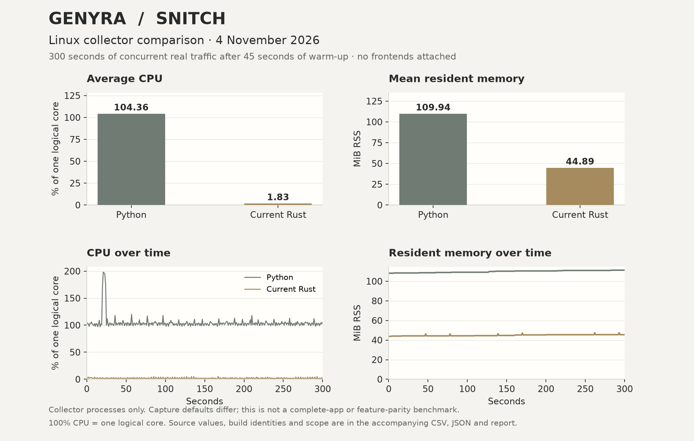

# Linux collector comparison — 4 November 2026

Two fresh collector processes captured the same real network interface concurrently
for **300 seconds**, after a **45-second warm-up**. No frontend was attached to
either collector. The current Rust collector used less CPU and RSS in this run.



[Vector chart](2026-11-04-linux-capture.svg). The chart is generated directly
from the numeric CSV/JSON with `scripts/plot-resource-comparison.py`; it does
not rerun or change the measurements. A new whole-application and visual-timing
comparison is paused during the native UI revision. No preliminary application
figures are substituted for a completed test of that revised interface.

| Measurement | Original Python collector | Current Rust collector |
| --- | ---: | ---: |
| Average CPU, percent of one logical core | 104.36% | 1.83% |
| Mean process RSS | 109.94 MiB | 44.89 MiB |
| RSS at measurement start | 108.21 MiB | 43.79 MiB |
| RSS at measurement end | 111.33 MiB | 45.52 MiB |
| Highest sampled RSS | 111.33 MiB | 47.52 MiB |
| Delivered / processed packets during the window | 87,626 | 87,652 |
| Captured frames during the window | 88,230 | 93,591 |
| Reported parser failures during the window | 0 | 6 |
| Reported libpcap kernel drops | Not exposed by this API | 0 |

CPU was **98.24% lower** and mean RSS **59.17% lower** in this workload.
100% CPU means one logical core, so Python averaged approximately 1.04 cores
and Rust 0.018 cores. These are process measurements, not percentages of the
whole 32-thread machine. The packet counters have implementation-specific
definitions and small differences in the times at which diagnostics were read.
Python also reported zero packet-queue drops; that does not establish zero
kernel drops. Rust reported zero interface drops as well as zero kernel drops.

## Builds and environment

- Intel Core i9-14900K, 32 logical CPUs, Linux x86-64, kernel `7.2.8-9-omarchy`.
- Original Snitch 1.6.4: commit `062f2a8c3ba95ac811988710579874100d667956`,
  clean source checkout, Python 3.12.15.
- Rust collector 0.1.0-alpha.2: source commit
  `c120556eaacbe66b5f618ad46299f0a7172a66d1`, built with
  `cargo build --release --locked`, Rust 1.99.1.
- Both used fresh, separate SQLite databases and identical local DB-IP City
  (126,998,165 bytes) and ASN (9,566,363 bytes) database files.
- Both ran as the same normal user with only `CAP_NET_RAW`. eBPF was disabled
  in both fresh configurations. Default background checks remained enabled.
  No on-demand Frida/deep inspections, model requests or firewall policy were
  configured. API endpoints were authenticated and bound to loopback.
- Existing host applications and the installed monitor continued running.
  No deliberate traffic load was generated. Temporary collectors stopped
  gracefully afterward; the installed monitoring service was not restarted.

## Important differences and limits

This compares the applications' capture defaults. Rust uses non-promiscuous
capture, a 4,096-byte snapshot and an `ip or ip6 or arp` filter. Python uses
promiscuous capture, a 65,535-byte snapshot and an `ip or ip6` filter. ARP and
passive device learning contribute to differences in frame counters. Larger
packets can be truncated in the Rust forensic buffer. This is not an identical
capture-policy experiment or proof that every inspection behaves equivalently.

The native desktop, optional Electron frontend, external models and kernel-side
allocations are excluded from these process numbers. The existing installed
collector was an older build; this result does not describe an installation
that has not been upgraded. No sustained maximum-throughput, minimum-RAM,
multi-hour stability or full cross-platform parity claim follows from this run.

RSS grew by 3.12 MiB for Python and 1.72 MiB for Rust between the measurement
endpoints. Five minutes is insufficient to establish a leak-free long run.
The [older 20-second sample](../PERFORMANCE.md#historical-20-second-sample)
had higher native RSS than Python. Builds, state and workloads differ between
those runs, so their change cannot be attributed to one optimization alone.

## Measurement method

The private harness sampled `/proc/PID/stat` once per second, checked process
start-time identity and included all threads in each collector process. CPU
was calculated as `100 × Δ(utime + stime) / CLK_TCK / elapsed_seconds` across
the full window. RSS was the resident-page count times the system page size.
Mean and peak RSS use the 300 samples; start/end values were recorded separately.
All 600 collector samples were present, and integrated CPU agreed with the mean
of the per-second CPU readings. Numeric diagnostic counters were read at the
window boundaries. No captured connection details appear in the published data.

[Machine-readable aggregate measurements](2026-11-04-linux-capture.json)
include exact values, source revisions and the Rust binary SHA-256. The
[600 per-second resource samples](2026-11-04-linux-capture.csv) contain only
elapsed time, collector label, CPU percentage and RSS bytes.
Traffic databases, tokens, logs, host integrations and packet data stay local.

For a repeat run, start fresh isolated collectors with equivalent data,
settings and capture permissions, verify that both are receiving packets,
allow a warm-up, then sample for at least five minutes. The repository also
includes a Rust process sampler:

```sh
cargo build --release --locked --manifest-path desktop/Cargo.toml --bin genyra-resource-probe
./desktop/target/release/genyra-resource-probe \
  --pids PYTHON_PID,RUST_PID --seconds 300 --interval 1 > samples.csv
```

Replace the PID placeholders with the actual collector PIDs. Benchmark visible,
minimized and closed-window desktop phases separately before quoting full-app
resource savings. Keep model and inspection workloads separate.
